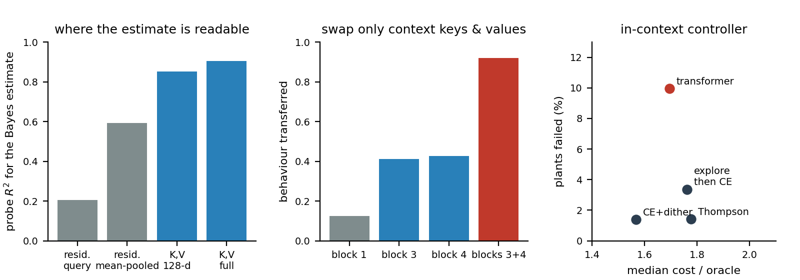
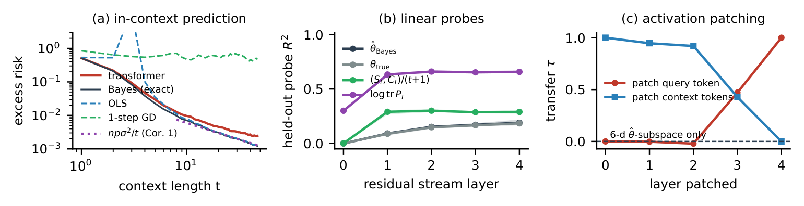
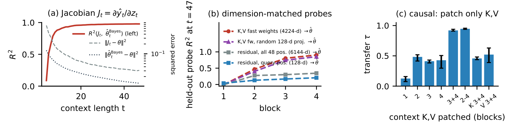
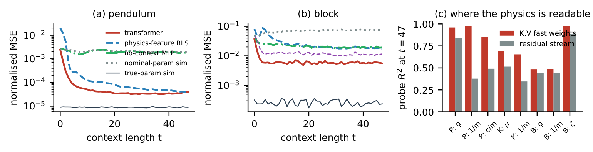
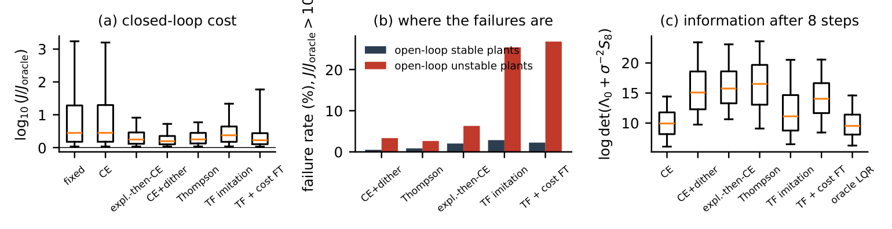

<p align="center">
  
</p>

# SUSS

[](paper/main.pdf)
[](https://nonberw.github.io/suss/)
[](https://nonberw.github.io/suss/demo/)
[](https://doi.org/10.5281/zenodo.24031898)
[](https://github.com/nonberw/suss/actions/workflows/tests.yml)
[](https://github.com/nonberw/suss/blob/prereg-d134c5a/PREREGISTRATION.md)
[](https://colab.research.google.com/github/nonberw/suss/blob/main/notebooks/quickstart.ipynb)
[](LICENSE)

**What does a transformer compute when it has to suss out unknown physics from a few seconds of history?**

You hand a small transformer 48 steps of a system it has never seen. Unknown mass, unknown friction, unknown which way the motor even pushes. It has to predict what happens next, or keep the thing from flying off into the void, with no gradient steps, purely in-context. The vibe is "it's giving system identification". This repo opens the model up and checks whether the vibe is real, and where exactly it lives.

A pre-registered, mechanistic study, trained from scratch on a laptop GPU (RTX 3050 Ti, 4 GB). Hypotheses were committed before any main experiment ran (tag `prereg-d134c5a`). Everything that changed afterwards, including two bugs we found in our own code and an external review we acted on, is in [`docs/DEVIATIONS.md`](docs/DEVIATIONS.md).

**[Paper (PDF)](paper/main.pdf)** | **[Live demo](https://nonberw.github.io/suss/demo/)** | **[Project page](https://nonberw.github.io/suss/)** | **[Quickstart notebook](notebooks/quickstart.ipynb)** | **[Trained models](https://github.com/nonberw/suss/releases/tag/v0.1.3)** | **[Pre-registration](PREREGISTRATION.md)** | **[Deviations](docs/DEVIATIONS.md)**

## TL;DR

Numbers are from `results/summary.json`: 3 pre-registered training seeds per model (10 for the replication of experiment A), 4096 test episodes, hierarchical bootstrap, Holm correction over the 13 pre-registered tests. Anything added after the pre-registration is labelled exploratory, here and in the paper.

**1. Bayes-optimal until it isn't.** On linear systems with unknown (A, B), the transformer tracks the *exact* Bayes predictor while data are scarce (within 1.23x up to t = 4), then flattens at an approximation floor: 1.59x the Bayes excess risk averaged over contexts (pre-registered tolerance was 1.25x, so that hypothesis is rejected). Exploratory scale study: training 3x longer or doubling depth brings it to ~1.22x, doubling width (4x parameters) to 1.30x, and a 0.1M-parameter model sits at 5.3x. Still not 1.

**2. The pre-registered mechanism is wrong, and we say so.** We bet the model writes its parameter estimate into the residual stream. It doesn't, at least not linearly or causally: the best linear probe gets R^2 = 0.19 (threshold 0.8), steering along the probe does nothing, and swapping the probe subspace between episodes transfers 0.0001 of the behaviour. Linear decodability told us nothing about causal use.

**3. The sufficient statistics live in the key-value memory.** Exploratory, with the controls a reviewer asked for. The attention fast weights Cov(v, k) of the last two blocks read the normalised sufficient statistics (S, C) with R^2 = 0.92 and the Bayes estimate with 0.90. Squash them to 128 dims and they still read 0.84-0.87; the residual stream tops out at 0.58-0.61 however you read it (query position, all 48 positions, mean-pooled, last context token). Shuffled labels: 0.00. Causally: swap only the context keys and values of blocks 3-4 with another episode's, touch nothing at the query, and 91-94% of the other episode's behaviour transfers. The same swap on block 1 alone: 7-16%. Two heads per block do most of it (0.78-0.82 vs 0.41-0.51 for two random heads). Replicated on 7 more seeds trained after the hypothesis was formed. The model's input Jacobian matches the Bayes estimate (R^2 = 0.92), which is what you'd expect if attention applies the stored statistics to the query. Fun twist: the pre-registered "statistics first, solve later" story was right about the *order* and wrong about the *place*.

**4. Physics.** On a block pushed around with Coulomb friction, the transformer beats linear-in-parameters physics regression by 3.2x and even beats structured system identification with the exact MuJoCo simulator (0.0058 vs 0.011): from (x, xdot) alone the contact state is hidden, and the transformer recovers it from history. On the pendulum, 1/m reads from key-value memory with R^2 = 0.97-0.98 vs 0.32-0.44 from activations. On a bouncing ball added later, the story only half-repeats, and we say that too.

**5. The in-context controller learns to explore, then hits the dual effect's other wall.** Trained by imitating an LQR oracle and then on closed-loop cost, it gathers 4.2 nats more information about the plant than certainty equivalence without dither (which gathers nothing about B, as the closed-loop identifiability identity says it must), though 1.4 nats less than dithered CE. Its median cost is competitive (1.69x oracle vs 1.57x dithered CE, 1.78x Thompson sampling), but it fails on 10% of plants vs 1.4%, almost all open-loop unstable. Fine-tuning on raw cost or on CVaR of the worst 10% diverges outright. Honest verdict: it explores, it's fine on a typical plant, and you shouldn't put it on an unstable one.

Plus: a scale study (longer, deeper, wider, a 4-state/2-input system), and the textbook theory restated for closed-loop in-context prediction (Bayes risk, its n p sigma^2 / t law, closed-loop non-identifiability), with proofs, presented as background rather than as a contribution.

## The scoreboard

13 pre-registered tests, Holm-corrected. 7 held up, 6 did not, including the headline mechanism. They all stay in the paper. Full table with confidence intervals and p-values: [`results/SUMMARY.md`](results/SUMMARY.md).

| Pre-registered test | Result | Verdict |
|---|---|---|
| H1a, H1b: transformer is closer to Bayes than to OLS / one-step GD | by 0.27 / 0.55 | supported |
| H1c: excess risk within 1.25x of Bayes | 1.59x [1.56, 1.62] | rejected |
| H2a: residual-stream probe reads the estimate, R^2 > 0.8 | 0.19 [0.17, 0.21] | rejected |
| H2b: that probe reads the Bayes estimate better than the true parameters | +0.005 | supported (barely) |
| H2c: sufficient statistics become readable at an earlier block than the estimate | all 3 seeds | supported |
| H3a, H3b: steering along the probe / swapping its subspace changes the prediction | slope 0.00, transfer 0.0001 | rejected |
| H4a: pushed block, transformer beats physics-feature RLS | 0.0058 vs 0.019 | supported |
| H4c, H4d: physical parameters linearly readable (R^2 > 0.5) and steerable on both systems | no / no | rejected |
| H5a: controller beats the best constant gain (mean cost) | by 584 [147, 1179] | supported |
| H5b: controller beats certainty equivalence (mean cost) | 112 [-149, 343] | not supported |
| H5d: controller gathers more information than CE by t = 8 | +4.2 nats [4.06, 4.31] | supported |

| Exploratory and descriptive results (added after the pre-registration) | Number |
|---|---|
| Key-value memory of blocks 3-4 reads the sufficient statistics / the Bayes estimate | R^2 0.92 / 0.90-0.91 |
| Same, after a random projection to 128 dims (the residual stream's width) | 0.75-0.76 / 0.84-0.86 |
| Best residual-stream readout of the same targets (query, all positions, mean-pooled, last token) | 0.68-0.71 / 0.58-0.61 |
| Swap only the context keys and values of blocks 3-4 (of block 1 alone) | 0.91-0.94 (0.07-0.16) of the behaviour transfers |
| Replication on 7 new seeds, 10 in total | KV swap 0.93 +- 0.01, KV probe 0.91 +- 0.01 |
| Pushed block: structured sysID with the exact MuJoCo simulator | 0.011, still behind the transformer's 0.0058 |
| Controller: median cost / oracle and plants failed | 1.69 and 10% (CE + dither: 1.57 and 1.4%) |

## Figures

<p align="center"></p>

**A, pre-registered.** (a) Excess risk vs context length: the transformer tracks the exact Bayes predictor while data are scarce, then flattens at an approximation floor; the Bayes curve follows the parameter-free n p sigma^2 / t law. (b) Held-out linear probes of the residual stream: the estimate is barely decodable, the posterior uncertainty is. (c) Activation patching: the query token carries the other episode's behaviour only from layer 3 on; the probe subspace carries nothing.

<p align="center"></p>

**A, exploratory: where the estimate lives.** (a) The predictor's Jacobian with respect to its query matches the Bayes estimate. (b) Probes for the estimate by block: projected to 128 dimensions, the key-value fast weights still beat the residual stream over all 48 positions. (c) Patching only the context keys and values of blocks 3-4, with every activation at the query untouched, transfers over 90% of the other episode's behaviour; keys or values alone transfer about half.

<p align="center"></p>

**B, MuJoCo.** (a, b) One-step error vs context length. On the pendulum the transformer is on par with physics-feature RLS, which there has the true model class; on the stick-slip block it beats it by 3.2x. (c) Physical parameters read from the key-value fast weights vs from the residual stream.

<p align="center"></p>

**C, control.** (a) Normalised cost J / J_oracle on 4096 paired test plants. Certainty equivalence without excitation never moves u, so it learns nothing about B. (b) Failure rate on open-loop stable vs unstable plants. (c) Information gathered in the first 8 steps.

## Live demo

[**nonberw.github.io/suss/demo**](https://nonberw.github.io/suss/demo/): the main model runs in your browser (plain JavaScript, no server). Pick an unknown system and watch the transformer's predictions and its own parameter estimate converge next to the exact Bayes estimator. `tests/test_demo.py` checks the JavaScript model against PyTorch.

## Quickstart (CPU, a few minutes)

The [quickstart notebook](notebooks/quickstart.ipynb) downloads one trained model (3 MB) from the release, makes fresh episodes and reruns the three headline checks: excess risk against Bayes, the residual vs key-value probe gap, and KV-only patching. It takes about 100 s on a laptop CPU; on Colab, click the badge at the top. Locally:

```bash
git clone https://github.com/nonberw/suss.git
```

```bash
cd suss && pip install -r requirements.txt jupyter
```

```bash
jupyter notebook notebooks/quickstart.ipynb
```

Loading a model yourself takes three lines:

```python
import torch
from suss.model import GPT, GPTConfig
ck = torch.load("runs/a/seed0.pt", map_location="cpu")
model = GPT(GPTConfig(**ck["cfg"])).eval(); model.load_state_dict(ck["state"])
```

All 51 checkpoints used in the paper (every seed of every experiment, the controller before and after fine-tuning, the scale study) are in `suss_models.zip` on the [v0.1.3 release](https://github.com/nonberw/suss/releases/tag/v0.1.3); the manifest is [`docs/MODELS.md`](docs/MODELS.md). Unzip at the repo root and every script finds them.

## Reproduce everything

```bash
pip install -r requirements.txt
```

```bash
python -m pytest -q tests
```

```bash
bash scripts/run_all.sh
```

`run_all.sh` runs everything in order with every seed fixed, writes `results/summary.json` and `results/SUMMARY.md` (the confirmatory table), generates `paper/numbers.tex` (every number in the paper is a macro computed from the results, nothing is typed by hand), draws the figures, builds the PDF with Tectonic and packs `submission/`. Budget about a day on a 4 GB laptop GPU. It's slower if you also train three other projects on the same laptop and let it fall asleep twice. Ask us how we know.

## Repo map

```
suss/            model (GPT with probe/steer/patch hooks), exact estimators, MuJoCo systems, control, stats
scripts/         train_*, eval_*, mech_*, sysid_block, scale_a, analyze, make_numbers, make_figures, run_all.sh
scripts/ops/     the queue scripts that actually ran the experiments on a shared laptop GPU
notebooks/       quickstart.ipynb: the headline result on a CPU in a few minutes
tests/           estimators, theory identities, hooks, KV patching, LQR, MuJoCo, stats (run by CI on every push)
results/         summary.json, SUMMARY.md, pilot logs (large raw outputs are regenerated, not committed)
paper/           the paper: main.tex -> main.pdf, numbers.tex (generated), figs/
docs/            LITERATURE.md (novelty check, every reference verified), DEVIATIONS.md, SUBMISSION.md,
                 MODELS.md, the project page (index.html, figs/) and the live demo (demo/)
hf/              model card for the Hugging Face Hub (upload with scripts/upload_hf.py)
```

## Cite

```bibtex
@misc{zhambakin2026suss,
  author       = {Zhambakin, Anuar},
  title        = {What a Transformer Learns When It Adapts to Unknown Physics In-Context:
                  Probing, Patching and Controlling},
  year         = {2026},
  howpublished = {Preprint},
  doi          = {10.5281/zenodo.24031898},
  url          = {https://github.com/nonberw/suss}
}
```

The DOI is Zenodo's concept DOI: it always resolves to the latest archived version. GitHub's "Cite this repository" button reads [`CITATION.cff`](CITATION.cff).

## Status

Preprint (v0.1.x). Not peer reviewed. Target venue: L4DC 2027; see [`docs/SUBMISSION.md`](docs/SUBMISSION.md). Single author (Anuar Zhambakin), with heavy AI assistance (disclosed in the paper). Issues and "you're wrong because" welcome.

## License

MIT. Go wild.
